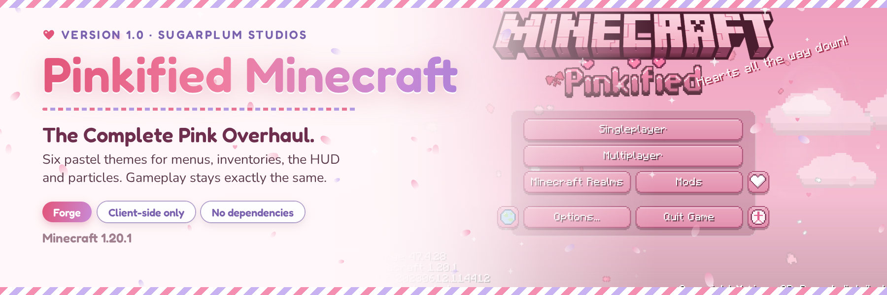

## The Complete Pink Overhaul.

**Pinkified Minecraft** turns Minecraft's whole interface soft and pastel: the main menu, every inventory, the HUD, tooltips, particles and the menu music. Pick one of **six themes** (or build your own from any two colours) and everything changes at once, with no resource reload.

It's **client-side only** and changes **no gameplay**. Servers never need it, and you can join any server with it installed. Every part can be switched off on its own, so you keep exactly as much pink as you like.

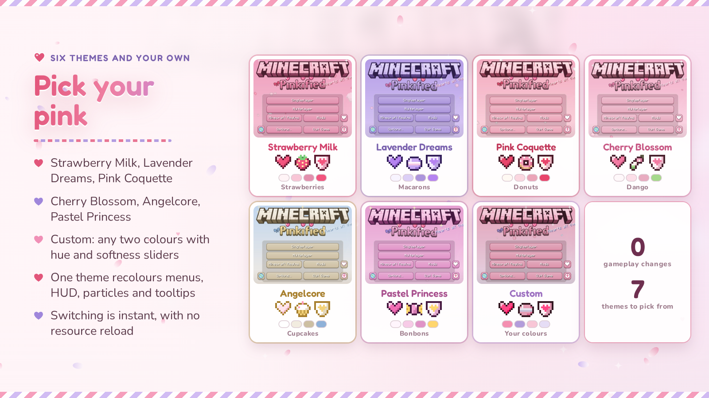

A theme recolours menus, containers, HUD icons, particles, tooltips, the enchantment glint and the main menu sky together. Each one comes with its own hunger treat.

| Theme | Feel | Hunger treat |
| --- | --- | --- |
| 🍓 **Strawberry Milk** | Milky pink panels, strawberry hearts and cream highlights | Strawberries |
| 💜 **Lavender Dreams** | Soft lilac and purple with dreamy pink accents | Macarons |
| 🎀 **Pink Coquette** | Baby pink and ivory tied with ribbon-red bows | Donuts |
| 🌸 **Cherry Blossom** | Sakura pink and white with a hint of spring green | Dango |
| 👼 **Angelcore** | Cream, white and gold with sky-blue glimmers | Cupcakes |
| 👑 **Pastel Princess** | Pink-lilac royalty with golden sparkle | Bonbons |
| 🎨 **Custom** | Any two colours you pick, with hue and softness sliders | Macarons |

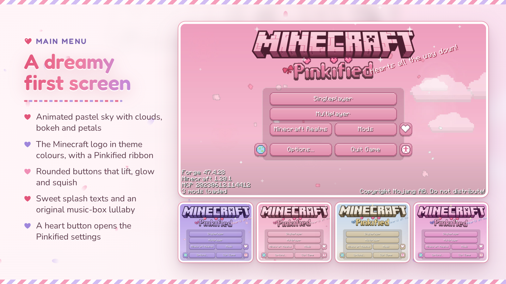

- An **animated pastel sky**: drifting clouds, soft bokeh light, falling petals and twinkling sparkles.
- The **Minecraft logo in theme colours**, with a "Pinkified" ribbon underneath.
- **Rounded buttons** that lift and glow on hover, show a little heart, squish when pressed and slide in one after another.
- Cute **splash texts**, a soft fade-in, and the Mods, language and accessibility buttons where you expect them.
- A **heart button** that opens the Pinkified settings.

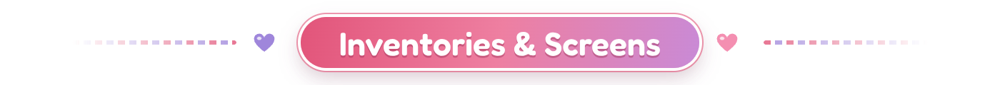

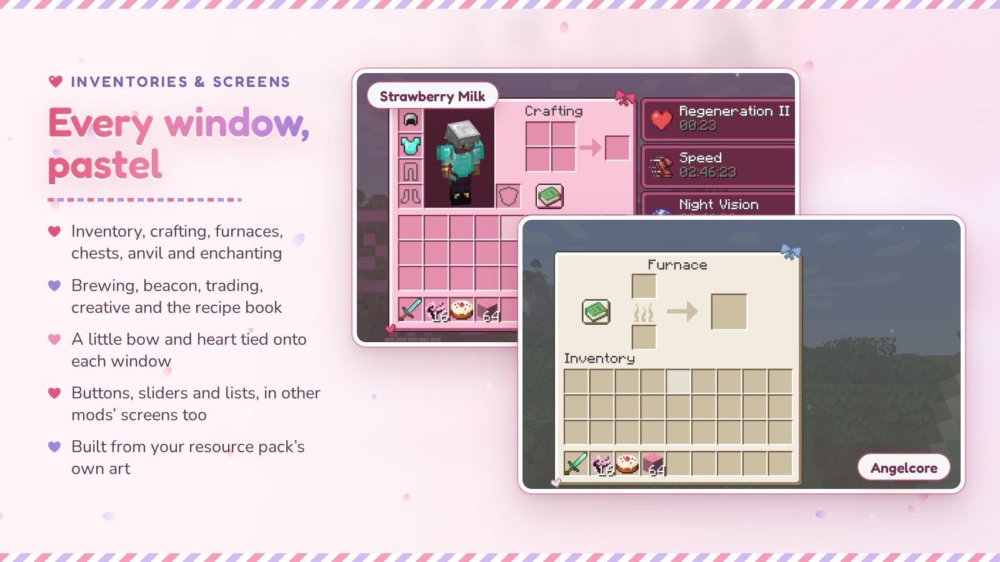

- **Containers:** the inventory, crafting table, furnace, blast furnace and smoker, anvil, enchanting table, chests, shulker boxes, hopper, dispenser, brewing stand, beacon, grindstone, loom, stonecutter, cartography and smithing tables, villager trading, horse inventory, creative inventory, recipe book and advancements. Each window gets a little **bow and heart** tied onto it.
- **Widgets:** buttons, sliders, checkboxes, list icons, toasts and tabs are recoloured, and buttons and the hotbar get softly rounded corners. Other mods' screens that use vanilla widgets get them too.
- **Lists:** server, world and option lists sit on rounded translucent panels.
- Everything is recoloured from **your active resource packs' own art**, so a pack's shapes and details stay in place.

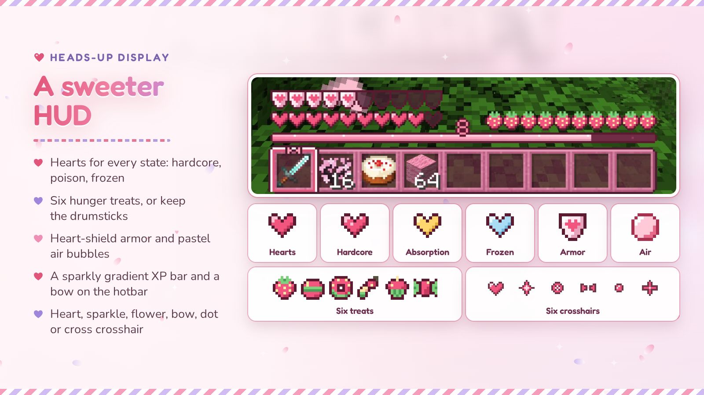

| Part | What you get |
| --- | --- |
| **Hearts** | Original pixel-art hearts for every state: normal, hardcore, absorption, poison, wither, frozen and mount, plus pastel air bubbles |
| **Hunger** | Six treats: strawberries, macarons, donuts, dango, cupcakes or bonbons. Follow the theme, pick one, or keep the drumsticks |
| **Armor** | Heart-shield armor icons |
| **Experience** | A gradient XP bar with sparkles, a matching level number and horse jump bar |
| **Hotbar** | A pastel hotbar with a bow on the selected slot |
| **Status effects** | Pastel effect icons and frames |
| **Crosshair** | Heart, sparkle, flower, bow, dot or cross, or keep the vanilla one |

The HUD is themed through textures, so vanilla still draws it and HUD mods keep working.

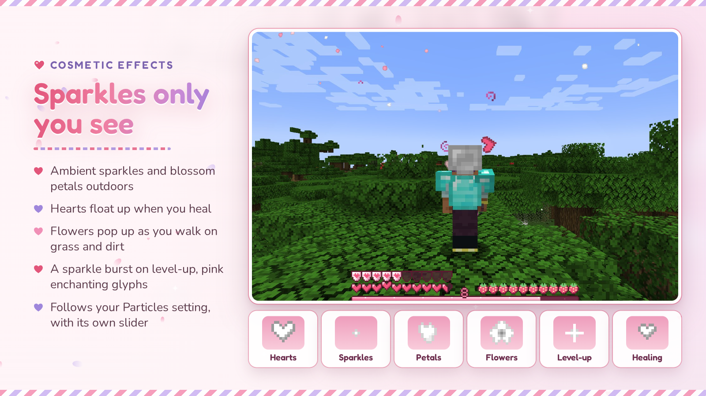

These particles are only on your screen. Nobody else on the server sees them.

- **Ambient sparkles** twinkling around you.
- **Cherry blossom petals** drifting down around you outdoors.
- **Little hearts** floating up when you heal.
- **Tiny flowers** popping up where you walk on grass and dirt.
- A **sparkle burst** when you gain a level.
- **Enchanting table glyphs** glowing in the theme colour.
- **Petals and sparkles** floating in menus.

They all follow the vanilla **Particles** setting, and a density slider (10% to 200%) sets how many spawn.

- **Sugarplum Lullaby**, an original music-box waltz, replaces the vanilla menu music. It follows your Music volume slider.
- Pinkified's own buttons play soft **chime** sounds.

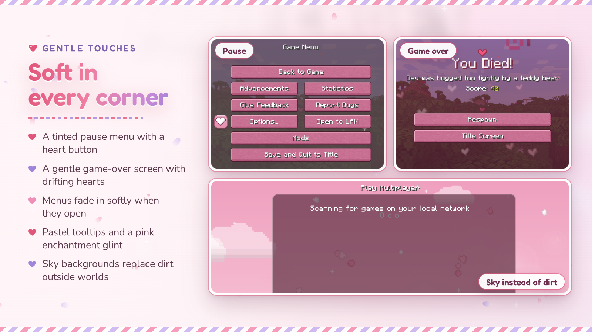

- **Pause menu:** a soft tinted backdrop and a heart button that opens the settings.
- **Game over:** a gentle pastel screen with drifting hearts instead of the red one.
- **Menu backgrounds:** the animated pastel sky replaces the dirt background outside worlds, and in-game menus get a soft tint.
- **Tooltips** in theme colours. Tooltips that other mods colour themselves are left alone.
- A **pink enchantment glint** on enchanted items.
- **Soft transitions:** menus fade in gently.

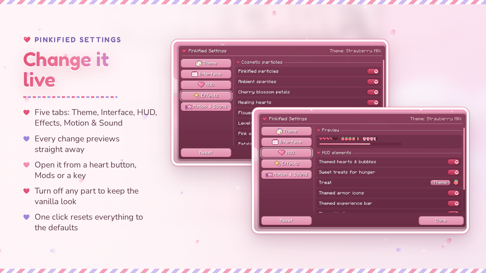

Open **Pinkified Settings** from the heart button on the main menu or pause menu, from **Mods → Pinkified → Config**, or with a key you bind under **Options → Controls → Pinkified** (unbound by default).

- Five tabs: **Theme**, **Interface**, **HUD**, **Effects** and **Motion & Sound**.
- Every change shows straight away, with a live preview of the HUD.
- **Reset** puts every setting back to its default.

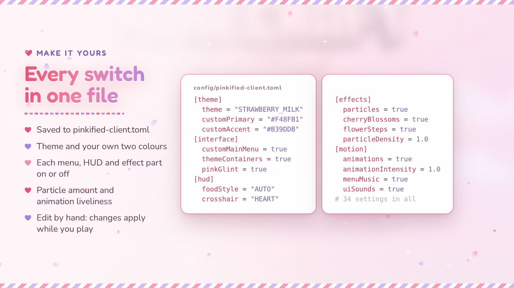

All 34 settings are saved to `config/pinkified-client.toml`, and you can edit it by hand while the game runs.

| Section | Settings |
| --- | --- |
| `[theme]` | `theme` (default `STRAWBERRY_MILK`), and `customPrimary` and `customAccent` for the Custom theme |
| `[interface]` | Containers, widgets, menu backgrounds, the Pinkified main menu, container bows, tooltips, the pink glint, the game-over screen and the pause-menu heart button |
| `[hud]` | Hearts and bubbles, hunger treats and `foodStyle`, armor, XP bar, hotbar, effect icons and `crosshair` (default `HEART`) |
| `[effects]` | A master `particles` switch, each of the seven effects, and `particleDensity` (0.1 to 2.0) |
| `[motion]` | `animations` and `animationIntensity` (0.1 to 2.0), screen transitions, menu music and button sounds |

Everything is on by default.

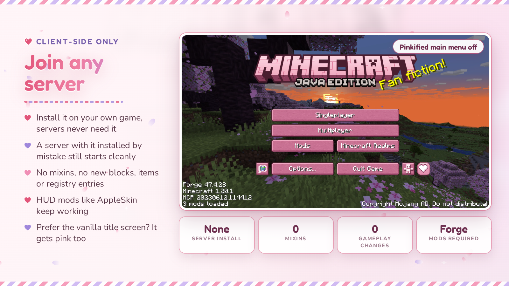

- **No mixins**, no access transformers, and no vanilla classes replaced. Pinkified adds no blocks, items or other registry entries.
- **Themed at runtime:** on every resource reload, Pinkified reads the GUI textures from your active resource packs and recolours them in memory, so vanilla and modded screens pick them up without changes.
- **Original art:** the HUD sprites, particles, logo, music and sounds are all made for Pinkified. No Mojang texture is redistributed.
- **Light touch:** screens are styled through Forge's screen events, and particles are spawned only on your client.

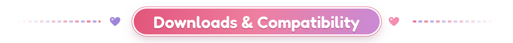

| Minecraft | Loader | Java | Also install |
| --- | --- | --- | --- |
| 1.20.1 | Forge 47 or newer | 17+ | Nothing |

- Install Pinkified on **your client only**: it is required on the client and unsupported on the server.
- **Resource packs:** Pinkified recolours whatever GUI textures your active packs provide. Turn off the matching settings to see a pack's art unchanged.
- **HUD mods** such as AppleSkin keep working, because hearts and food are themed through textures.
- **Mods that add buttons to the title screen:** those buttons don't appear on the Pinkified main menu. Turn off *Pinkified main menu* to keep the vanilla title screen, which is still recoloured.

**Known limitations**

- Only Minecraft's own interface textures are themed. Mods with their own GUI art keep it, but still get pastel backgrounds, tooltips and recoloured vanilla buttons.
- A few colours are fixed in Minecraft's code rather than its textures and stay vanilla: container label text, list scrollbars, boss bars and the loading screen.
- With HD resource packs, the custom HUD sprites are only painted when `icons.png` and `widgets.png` are a multiple of 256 pixels wide.
- Only English is included for now.

**Does the server need it?**
No. Pinkified is client-side only, so you can join any server with it installed.

**Does it change gameplay?**
No. It only changes how the interface looks and sounds. Blocks, items, mobs and the world are untouched.

**Will it work with my resource pack?**
Yes. Pinkified recolours your pack's own interface textures instead of replacing them, so the pack's shapes stay. If you'd rather see a pack's art unchanged, turn off the matching settings.

**Can I keep only some of it?**
Yes. Every part has its own switch: keep the HUD vanilla and the menus pink, or the other way round.

**Can I make my own theme?**
Pick **Custom** in the Theme tab and choose any two colours.

**Can other players see my particles?**
No. They're only drawn on your screen.

**Is there a Fabric or NeoForge version?**
Not yet. Pinkified runs on Forge for Minecraft 1.20.1.

More screenshots of every theme, the HUD, the inventories, the menus and the settings are in this project's **Gallery** tab.

---

Pinkified Minecraft is made by Sugarplum Studios and released under the Apache License 2.0. The Fredoka and Nunito fonts used in this artwork are licensed under the SIL Open Font License 1.1.
